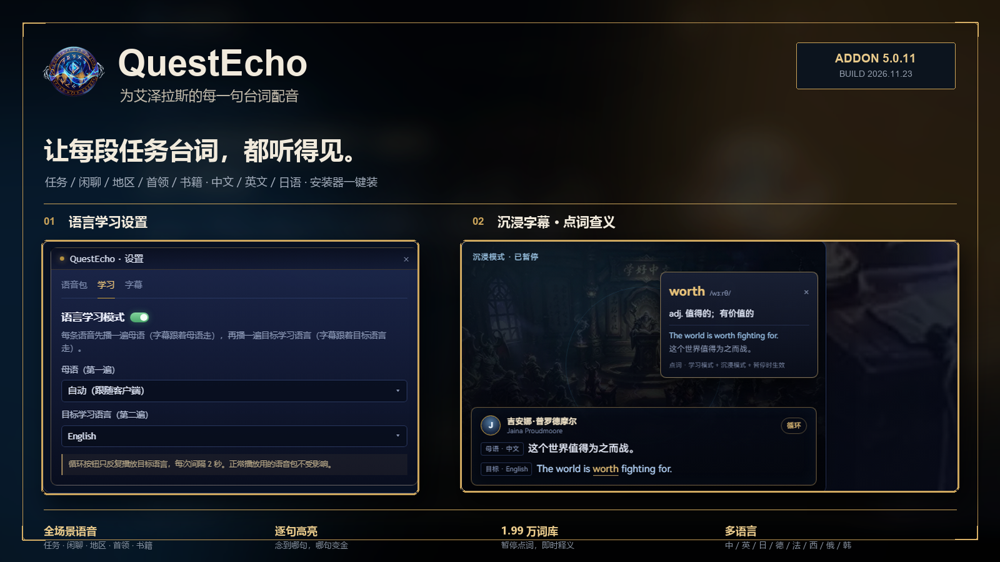

# QuestEcho

Bring every quest line in Azeroth to life — automatic NPC voice, bilingual captions, an immersive subtitle window, and a click-to-lookup reading mode for language learners.

[](https://github.com/LeySure/QuestEcho-Forever/releases)
[](https://github.com/LeySure/QuestEcho-Forever#compatibility)
[](https://questecho.dpdns.org/addons#installer)
[](https://ko-fi.com/leysure/tip)



QuestEcho is a lightweight World of Warcraft addon that plays voice lines for quests, gossip, zone narration, dungeon bosses and books. It does not change combat or quest logic; it only adds voice, captions and playback controls.

The core addon contains no audio. Voice packs are downloaded separately, either through the installer or from the release assets below.

## What is new in 5.0.11

- Japanese voice pack released: 12,628 quest lines, 2,254 gossip lines and 1,173 book lines, covering 5,591 quests. The pack can be selected directly in the installer.
- Japanese captions now use a bundled IPA font, so kana and full-width punctuation render correctly on Chinese and English clients.
- English voice pack rebuilt for 2026.11.23: 42,147 OGG files, 3.96 GB of source audio, including quests, gossip, zones, dungeon bosses and books.
- The installer is now 1.5.2 and reads the current online manifest, so the addon, Chinese, Japanese and English packs can be installed and updated in one place.

## Features

- Automatic playback on quest accept, progress, turn-in, NPC gossip, zone entry, boss kill and book reading.
- Azeroth Codex: quests, dungeons, places and books in one searchable window, with a play button on every voiced entry.
- Caption modes: status bar, subtitle-only, voice-only, and immersive mode with a large portrait and dialogue panel.
- Sentence-by-sentence caption highlighting: the line being spoken turns gold while the rest stays readable.
- Language learning mode: play the native language first, then the target language. `/qe learn on` enables it.
- Pause and click a word in immersive mode to get its Chinese meaning, part of speech and an official example line. The dictionary contains 19,900 entries.
- Playback queue, per-quest play buttons, loop and skip controls, plus a minimap button and key bindings.
- Voice packs for Chinese, English, Japanese, German, French, Spanish, Russian, Korean, Sichuanese and Cantonese are available through the installer / website.

## Download

Latest release: [5.0.11](https://github.com/LeySure/QuestEcho-Forever/releases/tag/5.0.11)

Recommended: use the installer. It detects the client, selects the correct voice packs, and keeps the addon and data packs up to date.

| File | Contents | Notes |
|---|---|---|
| `QuestEcho-Installer-Setup-1.5.2.exe` | Windows installer | Detects WoW clients and installs addon + voice packs |
| `QuestEcho-Installer-1.5.2-mac-arm64.zip` | macOS Apple Silicon installer | For M-series Macs |
| `QuestEcho-Installer-1.5.2-mac-x64.zip` | macOS Intel installer | For Intel Macs |
| `QuestEcho-Installer-1.5.2-linux-x64.AppImage` | Linux installer | x64 AppImage |
| `QuestEcho-5.0.11.zip` | Core addon | Required; about 40 MB |
| `QuestEchoData-zhCN-2026.11.22b.zip.001` `.002` | Chinese voice pack | Two volumes; download both |
| `QuestEchoData-jaJP-2026.11.22.zip.001` `.002` | Japanese voice pack | Two volumes; download both |
| `QuestEchoData-2026.11.23.zip.001` `.002` | English voice pack | Download all volumes of the same version |

Manual install: download the core addon and the voice packs, join the split volumes, extract, and place `QuestEcho`, `QuestEchoData`, `QuestEchoData-zhCN` and `QuestEchoData-jaJP` into `Interface/AddOns`.

Website and additional language packs: [questecho.dpdns.org](https://questecho.dpdns.org)

## Installation

1. Download the installer for your platform from the table above.
2. Run it and select the detected game client. Use “scan again” if a client is missing.
3. Choose the core addon and the voice packs you want, then install.
4. Enable `QuestEcho` and the matching data packs on the character-select screen.
5. Enter the game and use `/qe` to open settings.

For a manual install, extract the folders into:

```text
World of Warcraft/Interface/AddOns/
```

Split voice packs must be joined before extraction. Put all volumes in the same folder and extract the `.001` file with 7-Zip.

## Commands

| Command | Action |
|---|---|
| `/qe` | Open settings |
| `/qe settings` | Open the settings panel |
| `/qe captions on` / `off` | Toggle captions |
| `/qe style bar` | Status-bar display |
| `/qe style subtitle` | Subtitle-only display |
| `/qe style immersive` | Immersive portrait and subtitle window |
| `/qe style none` | Voice only |
| `/qe learn on` / `off` | Toggle language learning mode |
| `/qe compendium` | Open the Azeroth Codex |
| `/qe test` | Play a test line |
| `/qe diag` | Show diagnostics |
| `/qe help` | Show all commands |

## Compatibility

| Client | Status |
|---|---|
| Retail 12.x | Supported |
| Classic Era 1.15 | Supported |
| Forever (无限服) | Supported |
| Turtle WoW 1.12 | Supported |
| WLK 3.3.5a (Warmane) | Supported |
| TBC Anniversary | Supported |
| Titan Reforged | Supported |

The addon reads the client interface version at runtime. If a client reports the addon as outdated after a major patch, enable “Load out of date AddOns”; compatibility fixes are shipped in the next release.

## Support

If QuestEcho makes your leveling or role-play sessions better, you can support development on [Ko-fi](https://ko-fi.com/leysure/tip).

Bug reports and feature requests: [GitHub Issues](https://github.com/LeySure/QuestEcho-Forever/issues)

## 中文说明

QuestEcho 是一款魔兽世界沉浸式配音插件。接任务、交任务、和 NPC 闲聊、进入新地区、击杀副本首领、阅读书籍时，它会自动播放对应语音，并提供字幕、沉浸模式和语言学习功能。

核心插件不包含语音文件。语音包通过安装器或 Release 附件单独下载。安装器会自动识别客户端并勾选正确的语音包，支持 Windows、macOS 和 Linux。

5.0.11 更新重点：

- 日语语音包上线：12,628 条任务语音、2,254 条闲聊、1,173 条书籍，共覆盖 5,591 个任务；安装器可直接选装。
- 日语字幕改用自带 IPA 字体，中文和英文客户端不再出现假名方块。
- 英文语音包重建到 2026.11.23，42,147 个 OGG 文件，源音频约 3.96 GB。
- 安装器 1.5.2 会读取官网最新清单，插件、普通话、日语和英文包可以一起安装和更新。

主要功能：

- 任务、闲聊、地区旁白、副本首领、书籍全场景自动配音。
- 艾泽拉斯宝典：任务、副本、地区、读物统一检索，有语音的条目可直接播放。
- 状态栏、纯字幕、只听语音、沉浸模式四种显示方式。
- 字幕逐句高亮，念到哪句哪句变金。
- 英语学习模式：先念母语，再念目标语言；`/qe learn on` 开启。
- 沉浸模式暂停后点单词查释义，词库 1.99 万条，带词性和官方台词例句。
- 播放队列、任务播放键、循环、跳过、小地图按钮和快捷键。
- 中文、英文、日语、德语、法语、西班牙语、俄语、韩语、四川话、粤语语音包。

安装方法：

1. 从 Release 页面或 [官网](https://questecho.dpdns.org) 下载安装器。
2. 打开安装器，选择识别到的客户端；没有识别到时点“重新扫描”。
3. 勾选插件本体和需要的语音包，点击安装。
4. 在角色选择界面确认 `QuestEcho` 和对应的语音包已启用。
5. 进入游戏，输入 `/qe` 打开设置。

手动安装：把 `QuestEcho`、`QuestEchoData`、`QuestEchoData-zhCN`、`QuestEchoData-jaJP` 解压到 `Interface/AddOns`。分卷语音包需要把 `.001`、`.002` 放在同一目录，用 7-Zip 打开 `.001` 解压。

兼容客户端：正式服 12.x、经典旧世 1.15、无限服、乌龟服 1.12、巫妖王之怒 3.3.5a、燃烧的远征周年服、泰坦重铸。

遇到问题或有功能建议，请在 [GitHub Issues](https://github.com/LeySure/QuestEcho-Forever/issues) 反馈。
